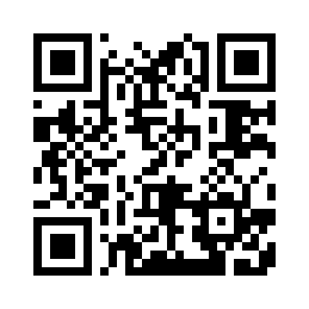
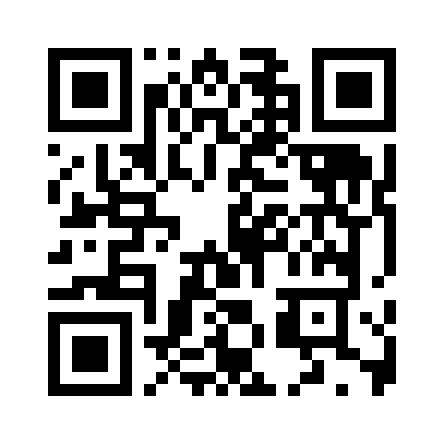

# Bitcoin Donate Address 2026

A simple public reference for the Bitcoin donation address supplied by **`cryptocoinland`**. This repository presents the address as copyable text and provides QR codes to help reduce manual-entry mistakes.

> **Verify before sending:** The format and checksum of the address below were validated, but that does not prove who controls it, establish that it belongs to a charity, or confirm that it is the recipient you intend to support. Independently verify the recipient through a trusted channel before making a payment.

## Bitcoin donation address

```text
1GwrQ5gPCq3ZJ9iC1D8Rr4feYtT2Q9RxEK
```

Copy the complete address exactly. This is a legacy Bitcoin mainnet address format (Base58Check, P2PKH). Send **BTC on the Bitcoin network only**; do not send other assets or use another network.

## QR codes

### Plain address QR code

This QR code encodes the address text exactly as shown above.



[Open the plain-address QR image](./bitcoin-donate-address-qr.png)

### Bitcoin payment URI QR code

This QR code encodes the standard-style Bitcoin URI `bitcoin:1GwrQ5gPCq3ZJ9iC1D8Rr4feYtT2Q9RxEK`. It does **not** set a payment amount, label, or message. Wallet behavior varies by application.



[Open the Bitcoin payment URI QR image](./bitcoin-payment-uri-qr.png)

## Address validation notes

A local Base58Check check passed for the exact string shown here:

- The string uses the Bitcoin Base58 alphabet and decodes to the expected 25-byte address payload.
- The four-byte Base58Check checksum matches the double-SHA-256 checksum.
- The version byte is `0x00`, consistent with a legacy Bitcoin mainnet pay-to-public-key-hash (P2PKH) address.

These checks detect certain input errors; they do **not** prove ownership, trustworthiness, balance, transaction history, or intended recipient. No private key is included or required to publish a receiving address.

## Safety checklist

1. Verify the recipient and address through a separate, trusted channel before sending funds.
2. After scanning, compare the address displayed in your wallet with the address above before approving the transaction.
3. Confirm that your wallet is sending BTC on the Bitcoin network and review the amount and network fee.
4. Never share a seed phrase or private key. A receiving address alone does not grant control of a wallet.
5. Remember that confirmed on-chain transactions are generally irreversible.

## Repository scope

This repository is an informational address reference. It is not a wallet, exchange, payment processor, investment service, or proof of charitable status. It does not process donations or guarantee any transaction, recipient, or use of funds.

## Maintainer

- GitHub profile: [`cryptocoinland`](https://github.com/cryptocoinland)
- Repository purpose: Bitcoin donation address reference and QR images

## References

- [GitHub documentation: About README files](https://docs.github.com/en/repositories/managing-your-repositorys-settings-and-features/customizing-your-repository/about-readmes)
- [GitHub documentation: Classifying your repository with topics](https://docs.github.com/en/repositories/managing-your-repositorys-settings-and-features/customizing-your-repository/classifying-your-repository-with-topics)
- [Bitcoin URI scheme specification (BIP 21; superseded by BIP 321)](https://bitcoin.org/bip/21/)
- [Google Search Essentials](https://developers.google.com/search/docs/essentials)

---

**Address last checked for encoding:** 2026-10-20. This date refers only to the format/checksum check, not an ownership or security audit.
